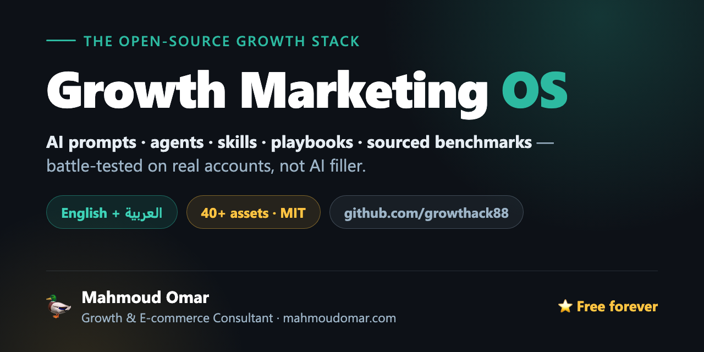

<div dir="rtl">

<div align="center">



# Growth Marketing OS

**مكتبة مفتوحة المصدر لأدوات التسويق بالذكاء الاصطناعي: برومبتات، Claude Skills، وكلاء، أدلة عملية (Playbooks) وأرقام مرجعية موثّقة، بالعربي والإنجليزي.**
بناها ويستخدمها [محمود عمر](https://mahmoudomar.com) في حسابات حقيقية للتجارة الإلكترونية والـ SaaS وتوليد العملاء في مصر والخليج والأسواق العالمية.

[طريقة الاستخدام](HOW-TO-USE.md) · [كتالوج الأصول](#كتالوج-الأصول) · [مركز قيادة الإعلانات](#مركز-قيادة-الإعلانات) · [المساهمة](CONTRIBUTING.md) · [رخصة MIT](LICENSE) · [English](README.md)

</div>

---

## المحتويات

- [ماذا ستجد هنا](#ماذا-ستجد-هنا)
- [ابدأ من هنا](#ابدأ-من-هنا)
- [مركز قيادة الإعلانات](#مركز-قيادة-الإعلانات)
- [مدرب التجارب](#مدرب-التجارب)
- [كتالوج الأصول](#كتالوج-الأصول)
- [خريطة الريبو](#خريطة-الريبو)
- [كيف يبنى كل أصل](#كيف-يبنى-كل-أصل)
- [ما الذي لم يكتمل بعد](#ما-الذي-لم-يكتمل-بعد)
- [المساهمة](#المساهمة)
- [الترخيص والإسناد](#الترخيص-والإسناد)
- [عن المؤلف](#عن-المؤلف)

## ماذا ستجد هنا

في الريبو **60 أصلًا أصليًا**، ومعها **13 موردًا من المجتمع** مرخّصة ترخيصًا مفتوحًا ومضافة مع ذكر مصادرها كاملة.

| النوع | العدد | يناسب |
|---|:---:|---|
| [البرومبتات](prompts/) | 25 | مهمة واحدة وإجابة واحدة: انسخ والصق في Claude أو ChatGPT أو Gemini |
| [الـ Skills](skills/) | 8 أصلية + 11 من المجتمع | سير عمل متكرر يشغّله مساعدك الذكي عند الطلب |
| [الوكلاء](agents/) و[الـ GPTs](gpts/) | 2 + 3 | مستشار دائم تجهّزه مرة واحدة كـ System Prompt أو Project أو Custom GPT |
| [الأرقام المرجعية](benchmarks/) | 7 | سؤال "هل هذا الرقم جيد؟"، وكل رقم منسوب لدراسة باسمها |
| [ملفات الإلهام (Swipe Files)](swipe-files/) | 4 | افتتاحيات وعناوين إيميل وعبارات CTA ورسائل واتساب بالعربي والإنجليزي |
| [الأدلة العملية](playbooks/) و[الأطر](frameworks/) | 3 + 2 | خطوات إطلاق عملية، والنماذج الذهنية التي تقف خلفها |
| [أمثلة تطبيقية](worked-examples/) | 4 | شرح كامل لمسار القرار (سيناريوهات افتراضية بأرقام مرجعية حقيقية) |
| [وصفات MCP](mcps/) و[الأتمتة](workflows/) | 1 + 1 | ربط الذكاء الاصطناعي بمتجرك وبخط إنتاج المحتوى |
| [موارد المجتمع](resources/) | 2 | دليل أدوات ومجموعة برومبتات منقولة بترخيصها (MIT / CC0) |

## ابدأ من هنا

| لو عايز… | افتح |
|---|---|
| تاخد رأي السوق الحقيقي قبل ما تطلق | [دليل التحقق قبل الإطلاق](playbooks/pre-launch-validation-playbook.md) + [قالب سجل التجارب](templates/EXPERIMENT_LOG_TEMPLATE.md) |
| نتيجة واحدة في 10 دقائق من غير أي إعداد | [مسار المبتدئين](HOW-TO-USE.md#-beginner-path--i-use-chatgptclaude-sometimes-im-not-technical) ← [Meta Ads Creative Diagnosis](prompts/paid-ads/meta-ads-creative-diagnosis.md) |
| تعرف ليه المبيعات نزلت | [Funnel Decomposition Analyst](skills/funnel-decomposition/SKILL.md) |
| تتأكد إن الرقم سيئ فعلًا | [الأرقام المرجعية](benchmarks/) + [Benchmark Analyst](skills/benchmark-analyst/SKILL.md) |
| تراجع أو تكبّر إعلاناتك في العالم العربي | [مركز قيادة الإعلانات](skills/mena-ads/README.md) |
| تشوف هل ChatGPT وClaude وGemini بيرشّحوا البراند بتاعك | [GEO LLM Visibility Audit](prompts/seo/geo-llm-visibility-audit.md) |
| تكتب كوبي عربي مش باين إنه مترجم | [Arabic Copy Localizer](skills/arabic-copy-localizer/SKILL.md) + [Bilingual Hook Bank](swipe-files/hooks/bilingual-hook-bank.md) |
| تدير متجر دفع عند الاستلام (COD) بربح حقيقي | [COD Profit Funnel](frameworks/cod-profit-funnel.md) + [COD Operations Analyst](skills/cod-operations-analyst/SKILL.md) |
| تبني أنظمة بدل برومبتات متفرقة | [المسار المتوسط](HOW-TO-USE.md#-intermediate-path--i-run-campaignsfunnels-and-use-ai-weekly) |
| تربط الأصول بأدواتك وخط عملك | [المسار المتقدم](HOW-TO-USE.md#-advanced-path--i-build-automations-agents-or-run-a-team) |
| تختبر فكرة أو تدير تجارب بمجرد ما تسأل الـ AI بتاعك | [مدرب التجارب](skills/experiment-coach/README.md) |

> دليل الاستخدام [HOW-TO-USE.md](HOW-TO-USE.md) متاح بالإنجليزية حاليًا.

## مركز قيادة الإعلانات

مركز قيادة الإعلانات (**MENA Ads Command Center**) هو Skill متكامل للإعلانات المدفوعة في العالم العربي. يغطي مراجعة الحسابات بنظام نقاط، وخطط الميديا، وقرارات التكبير والإيقاف، وكتابة إعلانات عربية حسب اللهجة، وحساب العائد الحقيقي على الطلبات المُسلَّمة في متاجر COD، وأدلة Snapchat وClick-to-WhatsApp، والتخطيط لرمضان. يعمل على Meta وGoogle وTikTok وSnapchat وLinkedIn وX.

للتثبيت في Claude Code:

<div dir="ltr">

```
/plugin marketplace add growthack88/growth-marketing-os
/plugin install mena-ads@growth-marketing-os
```

</div>

تستخدم ChatGPT أو Gemini أو Cursor أو Codex؟ ← [دليل التثبيت لكل أداة](skills/mena-ads/README.md#install-pick-your-ai) · [إعداد ChatGPT وGemini](gpts/mena-ads-gpt.md)

## مدرب التجارب

مدرب التجارب (**Experiment Coach**) مسؤول تجارب نمو موجود جوه الشات بتاعك. قوله "عندي فكرة وعايز أتأكد منها قبل ما أبنيها"، وهو يطلّع الافتراض الأخطر، ويكتب سكريبت المقابلات، ويحسب حد النجاح والعينة والميزانية من أرقامك، ويكتب صفحة الاختبار والإعلانات، ويحكم على النتيجة بقاعدة مكتوبة قبل البيانات. وبعد الإطلاق يرتّب التجارب، ويحسب اختبارات A/B ويقرأ نتايجها. بيشتغل كمان مع ملفات محاكاة GrowthLab، ومش بيخترع أرقام مرجعية.

للتثبيت في Claude Code:

<div dir="ltr">

```
/plugin marketplace add growthack88/growth-marketing-os
/plugin install experiment-coach@growth-marketing-os
```

</div>

تستخدم ChatGPT أو Gemini أو أداة تانية؟ ← [دليل التثبيت لكل أداة](skills/experiment-coach/README.md#install-pick-your-ai) · [إعداد ChatGPT وGemini](gpts/experiment-coach-gpt.md)

## كتالوج الأصول

المستوى: 🟢 مبتدئ · 🟡 متوسط · 🔴 متقدم. اللغة: إنجليزي، أو عربي + إنجليزي للأصول التي لها نسخة عربية أصلية (مكتوبة بالعربي، مش مترجمة). أسماء الأصول بالإنجليزية كما هي في الملفات.

<details open>
<summary><b>برومبتات: الإعلانات المدفوعة</b> (6)</summary>

| البرومبت | استخدمه لما | المستوى | اللغة |
|---|---|:---:|:---:|
| [Meta Ads Creative Diagnosis](prompts/paid-ads/meta-ads-creative-diagnosis.md) | إعلانات Meta بطّلت تحوّل وعايز تعرف السبب | 🟡 | إنجليزي |
| [Ad Angle Matrix](prompts/paid-ads/ad-angle-matrix.md) | محتاج 12 زاوية مختلفة لمنتج واحد حسب مستوى وعي الجمهور | 🟡 | إنجليزي |
| [Competitor Ads Teardown](prompts/paid-ads/competitor-ads-teardown.md) | عايز تفهم الاستراتيجية ورا مكتبة إعلانات منافس | 🟡 | إنجليزي |
| [Google Ads Search Terms Audit](prompts/paid-ads/google-ads-search-terms-audit.md) | ميزانية البحث بتتسرّب على كلمات غلط | 🟡 | إنجليزي |
| [Retargeting Ladder Builder](prompts/paid-ads/retargeting-ladder-builder.md) | الريتارجتنج بيعرض نفس الرسالة على الكل | 🟡 | إنجليزي |
| [Campaign Postmortem](prompts/paid-ads/campaign-postmortem.md) | حملة خلصت وعايز الحملة الجاية تستفيد من دروسها | 🟡 | إنجليزي |

</details>

<details>
<summary><b>برومبتات: SEO وGEO</b> (4)</summary>

| البرومبت | استخدمه لما | المستوى | اللغة |
|---|---|:---:|:---:|
| [GEO LLM Visibility Audit](prompts/seo/geo-llm-visibility-audit.md) | عايز تعرف هل ChatGPT وClaude وGemini بيرشّحوا البراند بتاعك | 🟢 | عربي + إنجليزي |
| [llms.txt Generator](prompts/seo/llms-txt-generator.md) | موقعك محتاج ملف <code>llms.txt</code> عشان مساعدات الذكاء الاصطناعي تستشهد بيه | 🟢 | إنجليزي |
| [AI Citation Optimizer](prompts/seo/ai-citation-optimizer.md) | عايز تعيد كتابة محتوى موجود بحيث النماذج تقتبس منه | 🟡 | إنجليزي |
| [Entity Schema Builder](prompts/seo/entity-schema-builder.md) | محتاج JSON-LD للشخص والمؤسسة | 🔴 | إنجليزي |

</details>

<details>
<summary><b>برومبتات: الإيميل</b> (3)</summary>

| البرومبت | استخدمه لما | المستوى | اللغة |
|---|---|:---:|:---:|
| [Abandoned Cart Recovery Sequence](prompts/email/abandoned-cart-recovery-sequence.md) | عندك متجر (حتى لو COD) والسلات بتتساب | 🟢 | عربي + إنجليزي |
| [Welcome Sequence Builder](prompts/email/welcome-sequence-builder.md) | المشتركين الجداد محتاجين 5 إيميلات من التسجيل لأول شراء | 🟡 | عربي + إنجليزي |
| [Win-Back and Reactivation Sequence](prompts/email/winback-reactivation-sequence.md) | جزء من قائمتك بقى خامل | 🟡 | عربي + إنجليزي |

</details>

<details>
<summary><b>برومبتات: تحسين معدل التحويل (CRO)</b> (3)</summary>

| البرومبت | استخدمه لما | المستوى | اللغة |
|---|---|:---:|:---:|
| [Review Mining Copy Bank](prompts/cro/review-mining-copy-bank.md) | عايز تحوّل تقييمات العملاء لكوبي تقدر تستخدمه | 🟢 | عربي + إنجليزي |
| [Landing Page CRO Teardown](prompts/cro/landing-page-cro-teardown.md) | صفحة أداؤها ضعيف وعايز تلاقي التسريب قبل ما تعيد تصميمها | 🟡 | إنجليزي |
| [Pricing Page Optimizer](prompts/cro/pricing-page-optimizer.md) | الباقات أو الأسعار المرجعية أو زر الفوترة محتاجين مراجعة | 🔴 | إنجليزي |

</details>

<details>
<summary><b>برومبتات: المحتوى والسوشيال</b> (6)</summary>

| البرومبت | استخدمه لما | المستوى | اللغة |
|---|---|:---:|:---:|
| [Content Repurposing Matrix](prompts/content/content-repurposing-matrix.md) | قطعة محتوى رئيسية واحدة لازم تغذي شهر توزيع | 🟢 | عربي + إنجليزي |
| [Lead Magnet Designer](prompts/content/lead-magnet-designer.md) | محتاج هدية مجانية تمهّد لبيع المنتج المدفوع | 🟢 | إنجليزي |
| [Case Study Writer](prompts/content/case-study-writer.md) | عندك نتايج بس مفيش دراسة حالة الناس تصدقها | 🟢 | عربي + إنجليزي |
| [YouTube Script Outline](prompts/content/youtube-script-outline.md) | الفيديوهات التعليمية بتخسر المشاهدين في أول دقايق | 🟡 | عربي + إنجليزي |
| [Arabic LinkedIn Content Engine](prompts/social/arabic-linkedin-content-engine.md) | فكرة واحدة لازم تبقى أسبوع بوستات بالعامية | 🟡 | عربي + إنجليزي |
| [UGC Brief Generator](prompts/social/ugc-brief-generator.md) | صنّاع المحتوى بيبعتوا تصوير مش صالح للاستخدام | 🟡 | عربي + إنجليزي |

</details>

<details>
<summary><b>برومبتات: النمو والعروض</b> (3)</summary>

| البرومبت | استخدمه لما | المستوى | اللغة |
|---|---|:---:|:---:|
| [Growth Experiment Designer](prompts/growth/growth-experiment-designer.md) | "خلّينا نجرب حاجات" لازم تتحول لقائمة تجارب مرتبة بالأولوية | 🟡 | إنجليزي |
| [Offer Stack Builder](prompts/growth/offer-stack-builder.md) | منتجك كويس بس لسه مش عرض الناس عايزاه | 🟡 | إنجليزي |
| [Referral Program Designer](prompts/growth/referral-program-designer.md) | عايز برنامج إحالة مربوط بلحظات حقيقية في رحلة العميل | 🔴 | إنجليزي |

</details>

<details>
<summary><b>الـ Skills والوكلاء والـ GPTs</b> (13 أصلية)</summary>

| الأصل | وظيفته | اللغة |
|---|---|:---:|
| ⭐ [MENA Ads Command Center](skills/mena-ads/README.md) | Skill كامل للإعلانات في العالم العربي: مراجعات، خطط ميديا، كريتيف، تتبّع، وعائد COD الحقيقي | عربي + إنجليزي |
| ⭐ [Experiment Coach](skills/experiment-coach/README.md) | يختبر الأفكار قبل الإطلاق ويدير التجارب بعده: مقابلات، اختبار دخان، بيع مسبق، حجم العينة، قراءة نتايج A/B، وسجل تجارب | عربي + إنجليزي |
| [Funnel Decomposition Analyst](skills/funnel-decomposition/SKILL.md) | تشخيص بالأرقام لسؤال "ليه المبيعات نزلت؟" من البيانات الخام | إنجليزي |
| [Benchmark Analyst](skills/benchmark-analyst/SKILL.md) | يجاوب "هل الرقم ده كويس؟" بأرقام مرجعية مطابقة وموثّقة | إنجليزي |
| [COD Operations Analyst](skills/cod-operations-analyst/SKILL.md) | الإيراد الحقيقي، وتكلفة المرتجعات، ونسبة التسليم اللي عندها تتعادل في متاجر COD | إنجليزي |
| [Arabic Copy Localizer](skills/arabic-copy-localizer/SKILL.md) | يحوّل كوبي إنجليزي لعامية طبيعية بقواعد واضحة للمزج بين اللغتين | عربي + إنجليزي |
| [Conversion Copywriter](skills/conversion-copywriter/SKILL.md) | كتابة إعلانية مباشرة بـ 5 أوضاع: كتابة، إعادة كتابة، مراجعة، افتتاحيات، تعليم | إنجليزي، يراعي العربي |
| [Performance Media Buyer](skills/performance-media-buyer/SKILL.md) | الإعلانات المدفوعة بـ 6 أوضاع: تخطيط، بناء، تحسين، تشخيص، مراجعة، تقارير | إنجليزي |
| [Growth Strategist Agent](agents/growth-strategist-agent.md) | System Prompt لمستشار نمو خبير | إنجليزي |
| [CRO Teardown Agent](agents/cro-teardown-agent.md) | System Prompt لمتخصص مراجعة معدلات التحويل | إنجليزي |
| [Growth Strategist GPT](gpts/growth-strategist-gpt.md) | إعداد Custom GPT جاهز للصق في ChatGPT | إنجليزي |
| [MENA Ads GPT](gpts/mena-ads-gpt.md) | مركز قيادة الإعلانات كـ ChatGPT Project أو Gemini Gem | عربي + إنجليزي |
| [Experiment Coach GPT](gpts/experiment-coach-gpt.md) | مدرب التجارب كـ ChatGPT Project أو Gemini Gem | عربي + إنجليزي |

وكمان **11 Skill من المجتمع** (MIT) لاختبارات A/B، والحد من فقدان العملاء، والـ Onboarding، والتموضع، وأبحاث العميل المثالي، وبطاقات المنافسين وغيرها ← [skills/community](skills/community/README.md).

</details>

<details>
<summary><b>الأرقام المرجعية</b> (7)</summary>

كل رقم منسوب لدراسة باسمها وسنتها ورابطها، ومعها بيانات خاصة بمنطقة MENA لما تكون متاحة.

| الملف | يغطي |
|---|---|
| [Paid Ads](benchmarks/paid-ads-benchmarks.md) | CTR وCPC وCPM وROAS على Meta وGoogle وTikTok حسب المجال |
| [CRO and E-commerce](benchmarks/cro-ecommerce-benchmarks.md) | التحويل في كل مرحلة من القمع، ومتوسط قيمة الطلب، وأسواق COD |
| [Email, SMS and WhatsApp](benchmarks/email-whatsapp-benchmarks.md) | الحملات، والتسلسلات الآلية، واسترجاع السلات، وأسواق COD |
| [SEO and GEO](benchmarks/seo-geo-benchmarks.md) | CTR حسب الترتيب، وأثر AI Overviews، والبحث بدون نقرات، واستشهادات النماذج |
| [Social Media](benchmarks/social-media-benchmarks.md) | التفاعل حسب المنصة، وأشكال محتوى LinkedIn، والاستخدام في MENA |
| [Content Marketing](benchmarks/content-marketing-benchmarks.md) | المدونات، والنشرات البريدية، والمؤثرين، والبودكاست، والويبينار |
| [SaaS and Growth](benchmarks/growth-saas-benchmarks.md) | التحويل من التجربة المجانية، والتفعيل، وفقدان العملاء، وNRR، واقتصاديات الوحدة |

</details>

<details>
<summary><b>الأدلة العملية والأطر والأمثلة التطبيقية</b> (9)</summary>

| الأصل | النوع | استخدمه لما |
|---|---|---|
| [Pre-Launch Validation](playbooks/pre-launch-validation-playbook.md) | دليل عملي | عايز رأي حقيقي (تسجيلات وبعدها فلوس) قبل ما تبني أو تطلق، والدليل بالعربي والإنجليزي |
| [Lifetime Deal Launch](playbooks/lifetime-deal-launch-playbook.md) | دليل عملي | تطلق منتج رقمي أو SaaS بسعر المؤسسين |
| [Shopify Direct-Checkout Offer](playbooks/shopify-direct-checkout-offer-playbook.md) | دليل عملي | تبني صفحات هبوط بتتخطى السلة |
| [COD Profit Funnel](frameworks/cod-profit-funnel.md) | إطار | الـ ROAS شكله كويس بس ربح الدفع عند الاستلام لأ |
| [Bilingual Content System](frameworks/bilingual-content-system.md) | إطار | تدير تسويق بالعربي والإنجليزي من غير ما تعمل كل حاجة مرتين |
| [COD Store ROAS Collapse](worked-examples/cod-store-roas-collapse-turnaround.md) | مثال تطبيقي | تتعلم تشخّص حساب إعلانات بينهار خطوة بخطوة |
| [SaaS Trial at 2%](worked-examples/saas-trial-conversion-turnaround.md) | مثال تطبيقي | تفهم ليه التفعيل قبل الإقناع |
| [Monetizing an 8K Newsletter](worked-examples/newsletter-monetization-launch.md) | مثال تطبيقي | تقارن بين الاشتراك المدفوع والرعاية والمنتجات بالحسابات |
| [Validating Before Launch](worked-examples/pre-launch-validation-walkthrough.md) | مثال تطبيقي | تشوف خطوات التحقق شغالة على فكرة واحدة، ومعاها نتيجتين "في النص" |

الأمثلة التطبيقية سيناريوهات افتراضية، ومكتوب عليها كده بوضوح، ومبنية على أرقام مرجعية حقيقية.

</details>

<details>
<summary><b>ملفات الإلهام وMCP والأتمتة</b> (6)</summary>

| الأصل | ما هو | اللغة |
|---|---|:---:|
| [Bilingual Hook Bank](swipe-files/hooks/bilingual-hook-bank.md) | 30 افتتاحية للإعلانات والمحتوى | عربي + إنجليزي |
| [Bilingual Subject Line Bank](swipe-files/subject-lines/bilingual-subject-line-bank.md) | 24 صيغة لعناوين الإيميل | عربي + إنجليزي |
| [Arabic CTA Bank](swipe-files/ctas/arabic-cta-bank.md) | 20 عبارة للأزرار والخواتيم في أسواق MENA | عربي + إنجليزي |
| [COD WhatsApp Script Bank](swipe-files/whatsapp/cod-whatsapp-script-bank.md) | رسايل تأكيد الطلب واسترجاعه والبيع الإضافي | عربي + إنجليزي |
| [Shopify MCP Growth Audits](mcps/shopify-mcp-growth-audits.md) | 5 وصفات لمراجعة متجر Shopify متصل بـ Claude عبر MCP | إنجليزي |
| [Repo-to-Content Flywheel](workflows/n8n/repo-to-content-flywheel.md) | خريطة n8n تحوّل كل Commit لمسودات بوستات وإيميلات (مواصفات فقط، ملف JSON لم يُنشر بعد) | إنجليزي |

</details>

<details>
<summary><b>موارد المجتمع</b> (2)</summary>

| المورد | ما هو | المصدر |
|---|---|---|
| [Awesome AI Marketing](resources/awesome-ai-marketing.md) | دليل أدوات تسويق بالذكاء الاصطناعي مع متى تستخدم كل أداة | [jmedia65/awesome-ai-marketing](https://github.com/jmedia65/awesome-ai-marketing) (MIT) |
| [Marketing prompts from prompts.chat](resources/marketing-prompts-from-prompts-chat.md) | 38 برومبت تسويقي منتقاة من مجموعة المجتمع | [f/prompts.chat](https://github.com/f/prompts.chat) (CC0) |

</details>

## خريطة الريبو

<div dir="ltr">

```
growth-marketing-os/
├── prompts/          paid-ads · seo · email · cro · content · social · growth
├── skills/           Claude / agent skills (SKILL.md) — community/ = curated MIT skills
├── agents/           system prompts for marketing agents
├── gpts/             Custom GPT, ChatGPT Project and Gemini Gem configs
├── benchmarks/       sourced market benchmarks
├── playbooks/        step-by-step launches and funnels
├── frameworks/       growth and mental models
├── swipe-files/      hooks, subject lines, CTAs, WhatsApp scripts (EN + AR)
├── worked-examples/  labeled teaching scenarios
├── mcps/             MCP recipes for marketers
├── workflows/        n8n / Make blueprints
├── case-studies/     real results (template ready, first entries pending)
├── resources/        vendored community resources
├── templates/        asset, case-study and experiment-log templates
└── llms.txt          machine-readable summary for AI assistants
```

</div>

## كيف يبنى كل أصل

- **قالب واحد.** كل أصل أصلي ماشي على [قالب الأصول](templates/ASSET_TEMPLATE.md)، ويبدأ ببيانات YAML (<code>title</code> و<code>category</code> و<code>type</code> و<code>level</code> و<code>works_with</code> و<code>language</code> و<code>last_verified</code>). البيانات دي مقروءة آليًا، فتقدر تحوّل الريبو لأدواتك الخاصة.
- **قسم "When I use it".** كل أصل أصلي بيقول جه من أنهي موقف، وإمتى تستخدمه.
- **أرقام موثّقة وبس.** الأرقام المرجعية منسوبة لدراسة باسمها وسنتها ورابطها، والأمثلة التطبيقية مكتوب عليها إنها افتراضية.
- **عربي أصلي، مش ترجمة.** الأصول ثنائية اللغة مكتوبة بالعامية المصرية أو الفصحى، مع مزج طبيعي لمصطلحات التسويق الإنجليزية.
- **المصدر واضح.** أي حاجة مش مكتوبة هنا موجودة في [`skills/community/`](skills/community/) أو [`resources/`](resources/) ومعاها مصدرها وترخيصها.
- **الروابط بتتفحص.** فيه [فحص آلي](.github/workflows/link-check.yml) بيوقف أي Pull Request فيه رابط داخلي مكسور.

## ما الذي لم يكتمل بعد

الصراحة في النواقص جزء من طريقة الشغل هنا:

- **دراسات الحالة:** [القالب](templates/CASE_STUDY_TEMPLATE.md) جاهز، لكن أول دراسات حالة حقيقية (بدون أسماء العملاء) لسه ما اتنشرتش. لحد ما تنزل، شوف [الأمثلة التطبيقية](worked-examples/).
- **ملفات JSON للأتمتة:** [الـ Workflows](workflows/) بتتنشر الأول كخرايط ومواصفات، وملف JSON بيتضاف بس بعد ما الفلو يشتغل فعلًا.

عايز أصل معيّن؟ [اطلبه من هنا](https://github.com/growthack88/growth-marketing-os/issues/new?template=asset-request.md)، أو [بلّغ عن حاجة قديمة](https://github.com/growthack88/growth-marketing-os/issues/new?template=broken-or-outdated.md).

## المساهمة

المساهمات مرحّب بيها، والمستوى المطلوب عالي: كل أصل لازم يمشي على [القالب الرئيسي](templates/ASSET_TEMPLATE.md) وفيه سيناريو استخدام حقيقي. اقرأ [CONTRIBUTING.md](CONTRIBUTING.md) و[قواعد السلوك](CODE_OF_CONDUCT.md) الأول.

## الترخيص والإسناد

الشغل الأصلي مرخّص بـ [MIT](LICENSE): مجاني لشغل العملاء والكورسات والوكالات. نقدّر ذكر المصدر بصيغة *Growth Marketing OS by Mahmoud Omar (mahmoudomar.com)*، وتفاصيله في [CITATION.cff](CITATION.cff).
الـ Skills والموارد اللي من المجتمع محتفظة بتراخيصها الأصلية (MIT أو CC0)، ونسخة الترخيص جنب كل ملف.

## عن المؤلف

**محمود عمر**: Growth Cofounder وFractional Head of Growth لشركات في مصر والخليج وMENA، ومؤسس Read to Lead.

الموقع: [mahmoudomar.com](https://mahmoudomar.com) · [يوتيوب: Growth Hack Academy](https://www.youtube.com/@GrowthHackAcademy?sub_confirmation=1) · [ماكينة النمو (Building Growth Machine)](https://buildinggrowthmachine.com) · [Growth OS: 17 أداة نمو](https://growthduckup.com) · [StartupKit Pro](https://startupkit.pro) · [DuckDoro](https://duckdoro.com)

لو الريبو وفّر عليك وقت، النجمة ⭐ بتساعد مسوقين تانيين يلاقوه.

</div>
